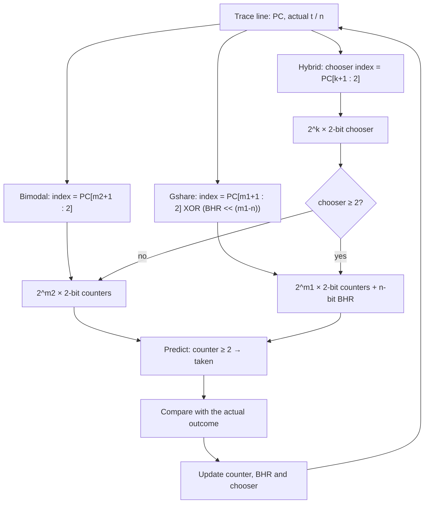
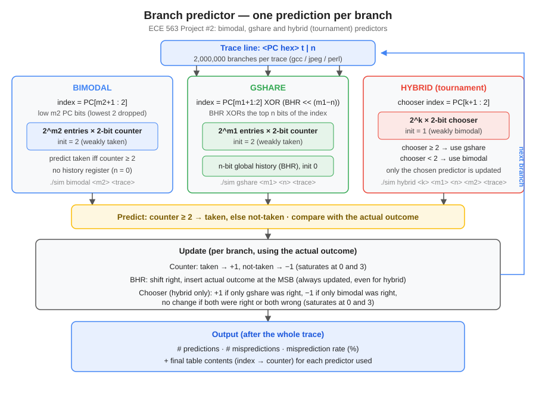
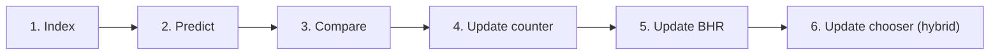
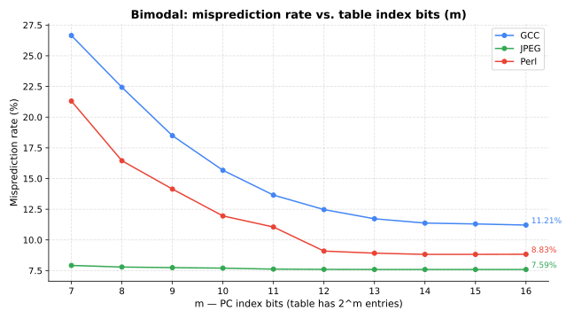
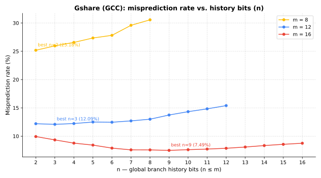
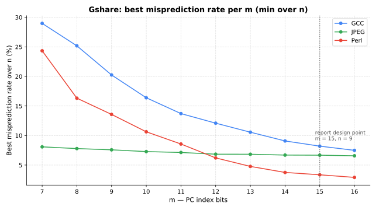

# Branch Predictor Simulator

A branch predictor simulator implementing **bimodal**, **gshare** and **hybrid (tournament)**
branch predictors, written in C++. Feed it a branch trace and it predicts every branch,
then reports the misprediction rate and the final contents of the predictor tables.

Course project — **NC State ECE 463/563, Fall 2018 (Rotenberg), Project #2: Branch
Prediction** (due November 16, 2018). The assignment spec is in
[`Report/proj2-f18.pdf`](Report/proj2-f18.pdf) and the write-up in
[`Report/Report.pdf`](Report/Report.pdf).

## Predictors at a glance

| Predictor | Parameters | Table | Index | Counter init |
|---|---|---|---|---|
| **Bimodal** | `m2` | 2^m2 entries × 2-bit counter | PC bits [m2+1 : 2] | 2 (weakly taken) |
| **Gshare** | `m1`, `n` (n ≤ m1) | 2^m1 entries × 2-bit counter + n-bit BHR | PC bits [m1+1 : 2] XOR (BHR << (m1−n)) | 2 (weakly taken), BHR = 0 |
| **Hybrid** | `k`, `m1`, `n`, `m2` | bimodal + gshare + 2^k-entry chooser | chooser index = PC bits [k+1 : 2] | chooser = 1 (weakly bimodal) |

All three use 2-bit saturating counters: predict **taken** when the counter is ≥ 2,
otherwise **not-taken**. There is no tag array — different branches can alias to the same
entry (interference is not detected or avoided, exactly as the spec requires).

## Architecture





### How one branch is predicted



1. **Index** — Bimodal uses the low `m2` PC bits (lowest two PC bits are always zero, so
   bits [m2+1 : 2] are used). Gshare XORs the branch history register into the top `n`
   bits of the `m1`-bit PC index. The hybrid chooser is indexed by PC bits [k+1 : 2].
2. **Predict** — read the 2-bit counter; ≥ 2 means taken.
3. **Compare** — the prediction is checked against the trace's actual outcome.
4. **Update counter** — taken → +1, not-taken → −1, saturating at 0 and 3. In hybrid
   mode only the *chosen* predictor's counter is updated.
5. **Update BHR** — shift the global history register right by one and insert the actual
   outcome at the MSB. The BHR is updated on every branch, even when the hybrid
   chooser picked bimodal.
6. **Update chooser (hybrid only)** — +1 if only gshare was right (saturates at 3), −1
   if only bimodal was right (saturates at 0), no change if both were right or both
   wrong.

The implementation is a single header-only class (`code/Branch_Predictor.h`): one
`prediction_model_parameters` entry per predictor (bimodal, gshare, chooser), each with
its own table, index width, BHR width, BHR value and mask.

## Build and run

```sh
cd code
make          # builds ./sim  (g++ -O3 -Wall)
make clean    # removes .o files and ./sim
make clobber  # removes .o files, keeps ./sim
```

```sh
./sim bimodal <m2> <trace>
./sim gshare <m1> <n> <trace>
./sim hybrid <k> <m1> <n> <m2> <trace>
```

Examples from the original README:

```sh
./sim bimodal 6 ../ValidationTraces/gcc_trace.txt
./sim gshare 9 3 ../ValidationTraces/gcc_trace.txt
./sim hybrid 8 14 10 5 ../ValidationTraces/gcc_trace.txt
```

A run must finish in under 2 minutes (spec requirement); a 2,000,000-branch trace takes
well under a second on a modern machine.

### Trace format

One branch per line: a hexadecimal PC followed by the actual outcome, `t` (taken) or
`n` (not-taken).

```
302d28 n
302d30 n
305b0c t
30093c t
30098c n
```

The three traces in [`ValidationTraces/`](ValidationTraces/) — `gcc_trace.txt`,
`jpeg_trace.txt`, `perl_trace.txt` — each hold 2,000,000 branches (18 MB each).

## Output

For every run the simulator prints a `COMMAND` echo, then an `OUTPUT` block with the
prediction count, the misprediction count and the misprediction rate (2 decimals),
followed by the final contents of each predictor table (`index → counter`, one entry
per line). Hybrid runs print three tables: chooser, gshare, bimodal.

Example — `./sim bimodal 6 gcc_trace.txt` (validation run 1):

```
COMMAND
./sim bimodal 6 gcc_trace.txt
OUTPUT
number of predictions:2000000
number of mispredictions:623425
misprediction rate:   31.17%
FINAL BIMODAL CONTENTS
0	2
1	1
2	3
3	2
...
63	0
```

## Validation

The ten posted validation runs (`validationResults/val_*.txt`) are matched exactly by
the simulator. The `output*.txt` files in the same directory are the author's own runs
of the same ten configurations — they also match the posted outputs exactly (only the
trace path in the `COMMAND` echo differs).

Verified by rebuilding the simulator from source and re-running all ten configs
(`diff -iw` against the posted files; the only differences are the trace path in the
`COMMAND` line):

| # | Command | Trace | Predictions | Mispredictions | Rate |
|---|---|---|---|---|---|
| 1 | `bimodal 6` | gcc | 2,000,000 | 623,425 | **31.17%** |
| 2 | `bimodal 12` | gcc | 2,000,000 | 249,344 | **12.47%** |
| 3 | `bimodal 4` | jpeg | 2,000,000 | 237,428 | **11.87%** |
| 4 | `bimodal 5` | perl | 2,000,000 | 621,034 | **31.05%** |
| 5 | `gshare 9 3` | gcc | 2,000,000 | 433,345 | **21.67%** |
| 6 | `gshare 14 8` | gcc | 2,000,000 | 186,773 | **9.34%** |
| 7 | `gshare 11 5` | jpeg | 2,000,000 | 146,629 | **7.33%** |
| 8 | `gshare 10 6` | perl | 2,000,000 | 230,495 | **11.52%** |
| 9 | `hybrid 8 14 10 5` | gcc | 2,000,000 | 207,922 | **10.40%** |
| 10 | `hybrid 5 10 7 5` | jpeg | 2,000,000 | 150,343 | **7.52%** |

> **Note — hybrid on a modern compiler.** As committed, the two hybrid validation
> runs aborted on a current g++ build: `initializeChooser()` never initialized the
> chooser's `bhrBitLength` / `bhr` / `bhrMaskValue`, so `getIndex()` read
> uninitialized memory and the simulator threw `std::out_of_range` (chooser index
> 1,179,466 vs. a 256-entry table). A 3-line fix in `code/Branch_Predictor.h`
> (initializing those three fields to 0) has been applied, and both hybrid runs now
> match the posted outputs exactly.

To check a run yourself (the spec's own procedure):

```sh
./sim bimodal 6 ../ValidationTraces/gcc_trace.txt > /tmp/out.txt
diff -iw /tmp/out.txt ../validationResults/val_bimodal_1.txt
```

## Results

### Graph 1 — Bimodal: misprediction rate vs. table size

Bimodal sweep, m = 7…16, one curve per trace. The rate falls as the table grows and
then saturates — JPEG saturates first (flat from m = 12), GCC and Perl keep improving
to m = 14–16.



| m | GCC | JPEG | Perl |
|---|---|---|---|
| 7 | 26.65% | 7.92% | 21.31% |
| 8 | 22.43% | 7.79% | 16.45% |
| 9 | 18.49% | 7.74% | 14.14% |
| 10 | 15.67% | 7.70% | 11.95% |
| 11 | 13.65% | 7.62% | 11.05% |
| 12 | 12.47% | 7.60% | 9.09% |
| 13 | 11.72% | 7.59% | 8.92% |
| 14 | 11.37% | 7.59% | 8.82% |
| 15 | 11.30% | 7.59% | 8.82% |
| 16 | 11.21% | 7.59% | 8.83% |

**Design (from the report, 16 KB budget):** bimodal with **m = 14** — GCC 11.37%,
JPEG 7.59%, Perl 8.82% — at 2^14 entries × 2 bits = 4 KB. Larger tables buy almost
nothing past this point.

### Graph 2 — Gshare: history length matters, and the best n moves with m

For small tables, more history hurts (aliasing); for large tables it helps. For every
m there is a best n, and it is a *middle* value, not the smallest or the largest —
and it grows with m.



Best gshare rate per m (minimum over n), with the argmin n:

| m | GCC (best n) | JPEG (best n) | Perl (best n) |
|---|---|---|---|
| 7 | 28.98% (n=2) | 8.08% (n=2) | 24.34% (n=2) |
| 8 | 25.18% (n=2) | 7.79% (n=2) | 16.32% (n=3) |
| 9 | 20.25% (n=2) | 7.58% (n=2) | 13.57% (n=2) |
| 10 | 16.39% (n=2) | 7.28% (n=7) | 10.63% (n=2) |
| 11 | 13.71% (n=2) | 7.13% (n=7) | 8.56% (n=7) |
| 12 | 12.09% (n=3) | 6.84% (n=8) | 6.21% (n=9) |
| 13 | 10.56% (n=7) | 6.83% (n=8) | 4.77% (n=13) |
| 14 | 9.08% (n=6) | 6.69% (n=8) | 3.75% (n=14) |
| 15 | 8.20% (n=7) | 6.67% (n=14) | 3.35% (n=12) |
| 16 | 7.49% (n=9) | 6.57% (n=14) | 2.91% (n=16) |



**Design (from the report, 16 KB budget):** gshare with **m = 15, n = 9** — GCC 8.23%,
JPEG 6.69%, Perl 3.72% — at 2^15 entries × 2 bits = 8 KB. The report's design point is
a joint optimum across all three traces (the per-trace minima above are slightly lower
for GCC at m = 16, n = 9: 7.49%).

> **A data-correction note.** The `graph/graph1/graph1.csv` and
> `graph/graph2/graph2.csv` originally shipped with their **GCC and Perl columns
> swapped** relative to the simulator's actual output files (verified on multiple
> rows, and cross-checked against `val_bimodal_2`, `val_gshare_1` and the report's
> design numbers). They have been regenerated from the per-run output files, so the
> tables and charts above now agree with the CSVs. The corrected tables are also in
> [`docs/graph1-data.csv`](docs/graph1-data.csv) and
> [`docs/graph2-data.csv`](docs/graph2-data.csv).

### Hybrid in one line

The hybrid's headline result is validation run 9: **10.40%** on GCC with
`hybrid 8 14 10 5`, versus 12.47% for the best bimodal at the same table size and
9.34% for gshare 14 8 — the chooser buys ~2 points over bimodal by letting gshare
win where history helps and falling back to bimodal where it does not.

## Repository layout

```
Branch_Predictor/
├── README.md                  # this file
├── docs/
│   ├── architecture.svg       # predictor + update-loop diagram
│   ├── graph1-bimodal.svg     # bimodal: rate vs. m
│   ├── graph2-gshare-n.svg    # gshare (GCC): rate vs. n
│   ├── graph3-gshare-best.svg # gshare: best rate per m
│   ├── graph1-data.csv        # corrected bimodal table
│   └── graph2-data.csv        # corrected gshare table
├── make_charts.py             # regenerates docs/ from graph/*/output*.txt
├── code/
│   ├── Branch_Predictor.h     # the predictor (header-only class)
│   ├── sim_bp.cc              # CLI driver: parse args, feed trace, print results
│   ├── sim_bp.h               # bp_params (K, M1, M2, N, bp_name)
│   ├── Makefile               # g++ -O3 -Wall, builds ./sim
│   └── bashScript.sh          # sweeps that produced graph1/graph2
├── ValidationTraces/          # gcc/jpeg/perl_trace.txt — 2,000,000 branches each
├── validationResults/         # val_*.txt (posted expected outputs)
│                              # + output*.txt (author's own runs of the same 10)
├── graph/
│   ├── graph1/                # graph1.csv + per-run outputs, bimodal m=7..16
│   └── graph2/                # graph2.csv + per-run outputs, gshare m=7..16
│                              # + ECE592LAb2.xlsx, graph2.xls/.xlsm workbooks
├── debugCode/                 # per-branch debug logs, first 10,000 branches
│                              # (bimodal/gshare/hybrid × validation configs 1–2)
└── Report/
    ├── Report.pdf             # project write-up (graphs, analysis, design)
    ├── ECE563_BranchPredictorReport2.doc
    └── proj2-f18.pdf          # assignment spec (ECE 563, due Nov 16, 2018)
```

## Reproducing the charts

```sh
python3 make_charts.py            # from a repo checkout; writes docs/
python3 make_charts.py --repo . --out docs
```

The script parses the misprediction rate out of the per-run output files in
`graph/graph1/` and `graph/graph2/` and writes the three
SVGs plus the two corrected CSVs.
